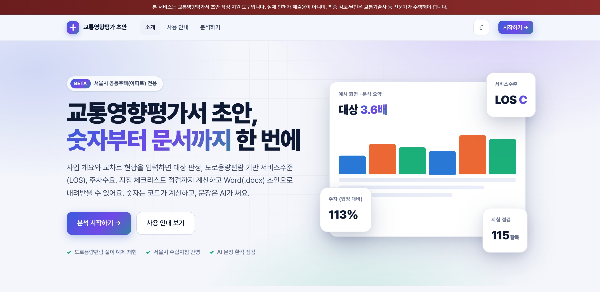
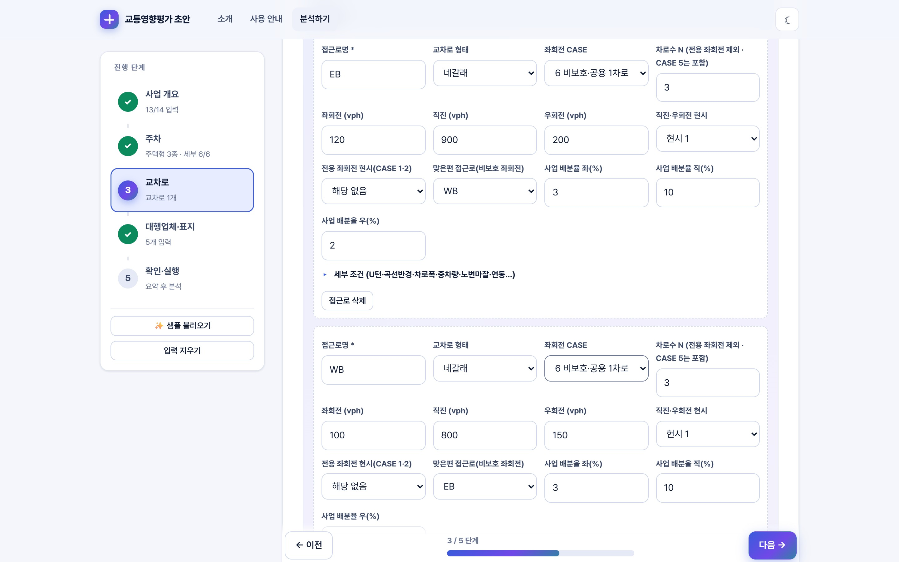
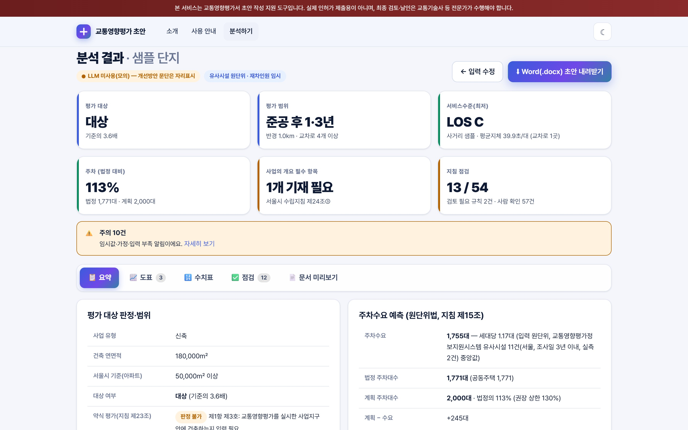

# 교통영향평가 초안 자동화

서울시 공동주택(아파트) 교통영향평가서 **초안**을 만드는 개인 프로젝트입니다.
사업 개요와 교차로 현황을 입력하면 평가 대상 판정, 유발교통량, 도로용량편람 기반 서비스수준(LOS, 사업 미시행·시행·개선 후), 주차수요, 지침 체크리스트 점검을 계산하고 서울시 양식의 Word(.docx) 초안을 내려받습니다. **숫자는 코드가 계산하고, 문장만 LLM이 씁니다.**

> **초안 작성 지원 도구입니다.** 실제 인허가 제출용이 아니며, 최종 검토·날인은 교통기술사 등 전문가가 해야 합니다.



| 입력(5단계 마법사) | 결과 대시보드 |
|---|---|
|  |  |

화면 캡처는 `scripts/capture_screens.py`로 다시 만들 수 있습니다(라이트·다크, 입력 5단계·결과 4탭 18장은 `docs/screenshots/`). 화면의 숫자는 샘플 입력 결과이며 실제 사업 값이 아닙니다.

## 무엇을 하나

- **대상·범위 판정**: 아파트 50,000㎡(서울), 복합용도(Swa), 증축 30%, 용도변경, 약식 평가(지침 제23조), 시간적·공간적 범위
- **유발교통량**: 유사시설 조사 원단위 + 직접 입력(발생·분담률·첨두·재차인원). 출처가 없는 값은 "잠정"으로 표시
- **서비스수준**: 도로용량편람(2013) 제8장 운영분석 — 차로군 분류, 직진환산, 보정계수, 연동계수, 초기대기지체. 좌회전 CASE 1~6, 세갈래 지원
- **개선 시나리오**: 녹색시간·주기 조정, 차로 증설, 전용 좌회전 차로 신설을 다시 계산해 지체 순으로 비교(물리적 개선은 "검토 후보"). 좌회전 차로 필요 길이는 평면교차로 설계 지침 기준으로 병기
- **주차**: 주택건설기준 규정과 서울 주차장 조례로 법정 대수, 계획 대비 130% 상한, 원단위 수요
- **지침 점검**: 서울시 수립지침 반영 체크리스트 115항목(자동 54·사람 확인 57·규칙 4)
- **문서**: 표지(별표 11)·제출문·사업의 개요·1~6장·별지 제1호·부록(분석 기준, 원단위 근거)을 Word로 조립
- **입력 보조**: 교통량 조사 CSV(15분 단위)에서 첨두시·PHF·접근로 교통량 자동 입력
- **환각 방지**: LLM 문장에서 계산 결과에 없는 수치·LOS 등급·근거 없는 "용량 초과" 표현을 찾아 다시 쓰게 합니다

## 어떻게 만들었나

멀티 에이전트가 하나의 상태(`ReportState`)를 돌려 쓰며 자기 몫만 채웁니다: **Planning**(대상·범위) → **Data**(유발교통량·LOS·주차) → **Creative**(표·도표) ∥ **AI**(문제점·개선방안 문단) → **Engineering**(Word 조립) → **Reflection**(체크리스트·환각 점검, 필요 시 재작성). 자세한 구조와 설계 판단은 [ARCHITECTURE.md](ARCHITECTURE.md).

- 백엔드: FastAPI, pydantic v2, python-docx, SQLite. 프런트: Jinja2 + 바닐라 JS/CSS(외부 CDN·폰트 없음, CSP 적용, 라이트·다크)
- 테스트 408개(항상 mock LLM, 외부 호출 없음): `python -m pytest -q`

## 검증

- **도로용량편람 풀이 예제 재현**: 예제 1(EB 접근로)과 예제 2(CASE 5 접근로)의 중간값·지체·서비스수준을 재현 — 예) CASE 5 접근로 지체 39.3초 일치, 교차로 54.5초(편람 53.5초, D). 편람 예제 사이의 불일치(E_R의 직진 가능 차로수)는 테스트에 명시했습니다.
- **지침 예시 재현**: 평면교차로 설계 지침의 좌회전 차로 길이 예시 6가지를 모두 재현
- **원단위 근거**: 국토교통부 교통영향평가정보지원시스템에 공개된 유사시설 조사(서울·경기·인천 아파트 278곳)를 수집해 조사일 3년 이내·서울 우선 중앙값으로 산출, 지침 요건(실측 1+자료 3 또는 실측 3) 충족 여부를 항목마다 점검
- **실제 Word로 열어 확인**: 샘플 문서를 Microsoft Word로 열어 PDF로 내보내 표지·목차·가로 쪽·표를 확인하고 레이아웃 문제를 수정했습니다

## 한계 (솔직하게)

- **현장조사와 설계 도면은 만들지 못합니다.** 교통량 조사, 주변가로 교통량, 종합개선안 도면은 사람이 준비해야 합니다(조사 CSV 업로드로 입력만 줄입니다).
- **우회전 2차로 이상 공용**은 편람에 계산식이 없어 지원하지 않습니다.
- **유사시설 '발생원단위'의 방향**(유입 기준 vs 양방향 합계)은 국토부 시스템 문서로 확정하지 못했습니다. 평가 실무 문헌을 근거로 유입 기준을 기본으로 하되 선택할 수 있고, 결과에 불확실성을 표시합니다.
- 평균 재차인원은 유사시설 자료에 없어 **직접 입력**하지 않으면 임시값입니다. 방문인구의 분담률은 상주와 같다고 가정합니다.
- 수집한 유사시설 값은 평가서가 입력한 그대로이며 검증하지 않았고 심의 전 사업이 섞여 있습니다.
- 실제 LLM으로 끝까지 돌려 본 결과는 아직 없습니다(테스트는 모두 mock). 실제 심의 사례와의 대조도 하지 않았습니다.

## 실행

```bash
python -m venv .venv
.venv\Scripts\activate          # macOS/Linux: source .venv/bin/activate
python -m pip install -r requirements.txt
cp .env.example .env            # 실제 LLM을 쓰려면 키를 채운다(없어도 mock으로 동작)
uvicorn app.main:app --reload --port 8000
```

브라우저에서 http://localhost:8000 을 열고 **분석하기 → ✨ 샘플 불러오기 → (3단계에서 "4방향 샘플 채우기") → 분석 실행**.

### LLM과 비용

- **"실제 LLM으로 문단 작성"은 기본 꺼짐**입니다. 꺼져 있으면 키가 있어도 외부 호출을 하지 않습니다. 켜면 호출이 여러 번 발생해 비용이 듭니다.
- 서버에 키가 없으면 켤 수 없습니다. 배포할 때는 **`APP_ACCESS_CODE`를 반드시 설정**하세요(실제 LLM 사용 시 코드를 요구). 시간당 횟수는 `MAX_LIVE_RUNS_PER_HOUR`(기본 10회)로 제한됩니다.
- `.env` 설정: [.env.example](.env.example)

### 인증(베타 초대 코드)과 저장소

- `BETA_CODES`를 설정하면 로그인(초대 코드)이 필요합니다. 세션 쿠키는 `SECRET_KEY`로 서명됩니다(HttpOnly, SameSite=Lax, 운영에서는 Secure).
- **`APP_ENV=production`에서는 `BETA_CODES`·`SECRET_KEY`(32자 이상)가 없으면 앱이 시작되지 않습니다.** LLM 키가 있는데 `APP_ACCESS_CODE`가 없어도 시작되지 않습니다.
- 로그인 실패는 같은 IP에서 10분에 `LOGIN_MAX_FAILURES`(기본 10)회까지입니다. 프록시 뒤에서는 `TRUST_PROXY=true`.
- 분석 결과는 SQLite(`DB_PATH`)에 `JOB_TTL_HOURS`(기본 72시간) 동안 저장되고 **계정별로 분리**됩니다(다른 계정은 job_id를 알아도 조회 불가).
- SQLite는 **단일 인스턴스 전제**입니다. 배포 시 `DB_PATH`를 영구 볼륨 경로로 지정하세요(임시 디스크면 재배포 때 결과가 사라집니다).
- **배포 절차(Railway)·환경변수·점검은 [docs/DEPLOY.md](docs/DEPLOY.md)**, 배포 전 점검은 `python scripts/predeploy_check.py`입니다.

### 화면과 API

| 메서드 | 경로 | 설명 |
|---|---|---|
| GET | `/`, `/guide` | 소개, 사용 안내(공개) |
| GET | `/app` | 분석 마법사(로그인 필요, 인증을 켠 경우) |
| GET | `/health` | 상태, LLM 사용 가능 여부, 인증 여부 |
| POST | `/api/login`, `/api/logout` | 초대 코드 로그인 |
| POST | `/api/analyze` | JSON 분석 요청 → 결과 요약(JSON) + `download_url` |
| POST | `/ui/analyze` | 화면이 쓰는 엔드포인트(결과 HTML 조각) |
| POST | `/api/counts/parse` | 교통량 조사 CSV → 첨두시·PHF·접근로 교통량 |
| GET | `/api/report/{job_id}.docx` | Word 초안 다운로드(소유자만) |

요청 필드는 `app/service.py`의 `AnalyzeRequest`를 보세요. 비율은 소수로 보냅니다(2% → `0.02`). 화면 주소에 `?theme=light|dark`를 붙이면 저장 없이 테마를 미리 볼 수 있습니다.

### 명령줄 도구

```bash
python scripts/export_docx.py              # 샘플로 DOCX 생성 (LLM은 mock 강제)
python scripts/export_docx.py --live       # 설정된 실제 LLM 사용(비용 발생)
python scripts/smoke_llm.py                # LLM 실연결 점검
python scripts/predeploy_check.py          # 배포 전 점검(--gen: 비밀 값 생성, --url: 배포 서버 점검)
python scripts/capture_screens.py          # 화면 캡처(서버를 먼저 띄우고, playwright 필요)
python scripts/collect_tia_evidence.py     # 유사시설 원단위 수집(교통영향평가정보지원시스템 공개 자료)
python scripts/build_unit_rate_evidence.py # 수집 원본 → data/unit_rate_evidence.csv
python -m pytest -q                        # 테스트(항상 mock, 외부 호출 없음)
```

## 근거 자료

- 교통영향평가 지침(국토교통부고시 제2021-317호), 서울특별시 교통영향평가 수립지침(제2017-43호), 도시교통정비 촉진법 시행령, 서울특별시 교통영향평가에 관한 조례
- 도로용량편람 2013(국토교통부) 제8장: 서비스수준 <표 8-2>, 지체식, 차로군 분류, 풀이 예제 — 원문 확인
- 평면교차로 설계 지침(건설교통부, 2004), 도로의 구조·시설 기준에 관한 규칙 제8조
- 주택건설기준 등에 관한 규정 제27조, 서울특별시 주차장 설치 및 관리 조례
- 교통영향평가정보지원시스템(tia.molit.go.kr) 공개 원단위정보, KTDB 가구통행실태조사 2016(참고 비교), 김익기·송태호(2004) 교통 기술과 정책 1(1), 경기연구원(2023) 원단위 연구

데이터 수집 경위와 한계는 [DATA_SOURCES.md](DATA_SOURCES.md), 작업 목록은 [BACKLOG.md](BACKLOG.md), 과정 산출물은 [DELIVERABLES.md](DELIVERABLES.md).
